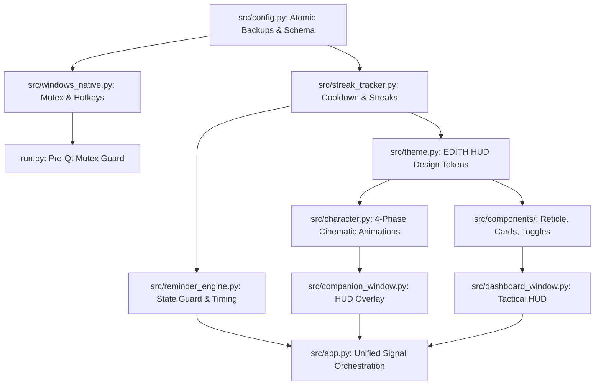

# 🕷️ Spider-Man Water Buddy — V1.0 to V2.0 Gap Analysis & Technical Dependencies

**Date:** 2026-10-23  
**Analysis Type:** Architecture & Feature Delta Assessment  
**Baseline:** v1.0.0 (`8700a13`)  
**Target:** v2.0.0 (`feature/v2.0`)  
**Status:** Complete  

---

## 1. Feature Status Breakdown Matrix

| Feature / Subsystem | V1.0 Status | V2.0 Requirement | Affected Modules | Gap & Required Modifications |
|---|---|---|---|---|
| **Reminder State Machine** | Buggy (`pass` on validation) | Authoritative state transitions & dual-entry logging | `src/reminder_engine.py`, `src/app.py` | Replace open validation with state guards; isolate manual logs from scheduled reminder state. |
| **Manual Water Logging** | Non-existent (only reminders) | "YES, I DRANK 💧" button with 30-min hard cooldown | `src/streak_tracker.py`, `src/dashboard_window.py` | Entirely new module `StreakTracker` with monotonic and wall-clock time tracking. |
| **Streak Tracking** | Non-existent | Consecutive day tracker with milestones & history | `src/streak_tracker.py`, `src/components/streak_card.py` | Entirely new subsystem; stores daily history, evaluates midnight rollovers, awards badges. |
| **Settings & Persistence** | Single `.bak` file, silent reset on corruption | Atomic write, multi-generation backups, corrupt quarantine | `src/config.py` | Implement 3-generation backup rotation (`.bak.1`, `.bak.2`, `.bak.3`) and quarantine bad files. |
| **Single-Instance Enforcement** | QLocalServer only (race condition on fast double-click) | Windows Kernel Named Mutex + QLocalServer activation | `run.py`, `src/windows_native.py`, `src/app.py` | Add `NamedMutexGuard` at top of `run.py` before `QApplication` instantiation. |
| **Global Keyboard Hotkey** | Focus-bound `QShortcut` | System-wide `RegisterHotKey` via Win32 API | `src/windows_native.py`, `src/app.py` | Add native event filter handling `WM_HOTKEY` and dynamic rebinding. |
| **Companion Animations** | Basic pendulum idle, abrupt state cuts | 4-phase cinematic web swing, celebration burst, disappointment slump | `src/character.py`, `src/companion_window.py` | Overhaul `SpideyWidget` with multi-phase animation controllers and easing curves. |
| **Dashboard UI/UX** | Aquatic blue gradient panels, progress bar | Stark Tech EDITH Tactical HUD with circular reticle | `src/theme.py`, `src/dashboard_window.py`, `src/components/` | Redesign UI tokens (pitch black + white/cyan laser lines), replace progress bar with circular reticle. |
| **Multi-Monitor & DPI Handling** | Absolute pixel coordinates (drifts on DPI change) | Relative corner offsets & visible screen clamping | `src/companion_window.py`, `src/windows_native.py` | Store offsets relative to desktop corners; clamp against `availableGeometry()`. |
| **Packaging & Build System** | Hardcoded `v1.0.0`, missing spec files | Centralized versioning, automated multi-spec build pipeline | `src/version.py`, `scripts/build_dist.py`, `packaging/` | Single source of truth for version; automated generation of Standalone and Installer binaries. |

---

## 2. V1.0 Bugs That Directly Interfere with V2.0

1. **CRIT-01 (`pass` guard) vs Manual Cooldown:**  
   If CRIT-01 were fixed naively by requiring `ReminderState.WAITING_FOR_RESPONSE` for all logging, the new Manual Log button would be completely blocked.  
   *Resolution:* Decoupled into `log_from_reminder()` and `log_manual()`, unified under `StreakTracker.log_water()`.
2. **HIGH-01 (Midnight stat bleed) vs Streak Rollover:**  
   If intake did not cleanly reset at midnight, yesterday's water count would artificially contribute to today's streak goal.  
   *Resolution:* Synchronous midnight date normalization performed before any streak calculation.
3. **HIGH-03 (Silent config reset) vs Daily History:**  
   If a corrupted file caused an automatic reset to defaults, user streak counts and historical drinking records would be wiped.  
   *Resolution:* Multi-generation backups and corrupted file preservation ensure zero history loss.

---

## 3. Dependency Graph & Sequencing

---

## 4. Potential Breaking Changes & Backward Compatibility

1. **Settings File Format Migration (`v1` to `v2`):**  
   - *Risk:* Old `settings.json` lacks streak fields (`streak_current`, `last_log_wall_utc`, etc.).  
   - *Mitigation:* `ConfigManager` uses dataclass field filtering with automatic defaults for missing fields. Existing user preferences (intervals, quiet hours, user name) are 100% preserved.
2. **Component API Signatures:**  
   - *Risk:* Replacing `LiquidReservoir` with the tactical HUD reticle could break external references to `_update_wave()`.  
   - *Mitigation:* Retained compatibility alias `_update_wave = _update_hud_tick` and identical Qt property names (`fill_level`).
3. **Reset to Idle Property Leaks:**  
   - *Risk:* Calling `reset_to_idle()` while the idle sway timer is active could leave non-zero swing angles.  
   - *Mitigation:* Explicit property reset in `set_animation_enabled(False)` and clean state teardown.

---

## 5. Technical Risks & Mitigation Strategies

| Risk | Severity | Mitigation Strategy |
|---|---|---|
| **System Sleep Monotonic Freeze** | High | `StreakTracker` calculates elapsed time against both monotonic and UTC wall clock, selecting the authoritative duration. |
| **DirectWrite Font Missing (Tofu boxes □)** | Medium | Removed quoted font names in QSS stylesheets; fallback sequence Segoe UI -> Cascadia Code -> Arial -> sans-serif. |
| **High CPU during Character Sway** | Medium | Throttled timer (30 FPS max) with automatic pause when window is hidden or minimized. |
| **PyInstaller File Missing (`sys._MEIPASS`)** | High | Centralized `resource_path()` helper resolving relative to executable root when bundled. |

---
*Gap Analysis complete. All dependencies and mitigation pathways established.*
