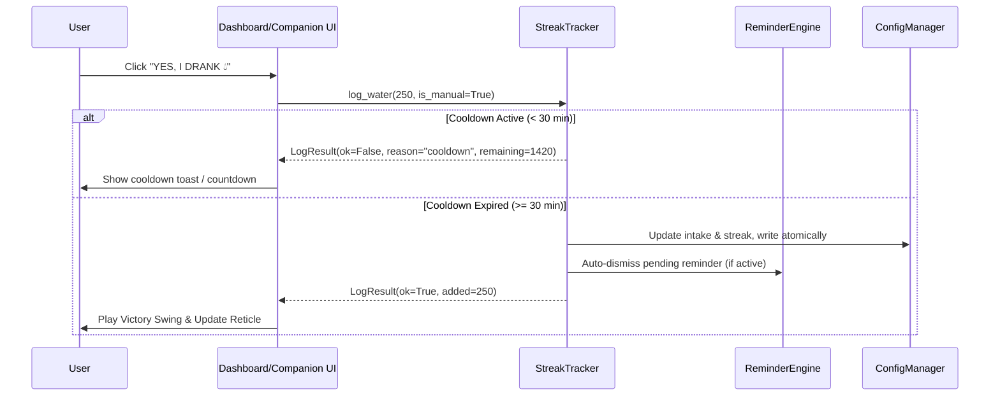

# 🕸️ Spider-Man Water Buddy — V2.0 Implementation Plan

**Date:** 2026-10-23  
**Target:** Spider-Man Water Buddy v2.0.0 Desktop  
**Status:** Approved for Implementation  

---

## 1. Implementation Phasing Strategy

The upgrade is executed across 6 synchronized phases, prioritizing stability, backward compatibility, and clean test verification at each step:

```
[Phase 1: Foundation & Security Hardening]
    │  • Win32 Named Mutex Guard (run.py)
    │  • Atomic JSON Storage & Generational Backups (config.py)
    │  • Zip path traversal sanitization (installer_gui.py)
    ▼
[Phase 2: Hydration Core & State Machine]
    │  • State validation guards (reminder_engine.py)
    │  • Dual-entry logging architecture (StreakTracker)
    │  • Monotonic, wall-clock & boot ID tracking (streak_tracker.py)
    ▼
[Phase 3: Streak & Achievement Subsystem]
    │  • Consecutive goal evaluation (streak_tracker.py)
    │  • Historical daily records retention (config.py)
    │  • Web Shield configurable toggle (streak_tracker.py)
    ▼
[Phase 4: Character Motion & Animation Upgrades]
    │  • 4-Phase Cinematic Web Swing engine (character.py)
    │  • Expressive disappointment reaction (character.py)
    │  • Idle pendulum damping and CPU optimization (character.py)
    ▼
[Phase 5: Tactical EDITH HUD & Modern Typography]
    │  • Pitch black & cyan laser theme tokens (theme.py)
    │  • Circular tactical reticle widget (liquid_reservoir.py)
    │  • Glass card, streak card & toggle components (components/)
    │  • Tactical HUD Dashboard window (dashboard_window.py)
    ▼
[Phase 6: Verification, Packaging & Distribution]
    │  • Automated test suite execution (pytest)
    │  • Standalone & Setup installer builds (PyInstaller + scripts/build_dist.py)
    │  • Release documentation & verification report
```

---

## 2. File-by-File Modification & Component Breakdown

### 2.1 `src/version.py` (New / Updated)
- **Role:** Single source of truth for versioning across the entire application, installers, and batch scripts.
- **Changes:**
  - Define `VERSION = "2.0.0"`
  - Define `APP_NAME = "Spider-Man Water Buddy"`
  - Define `FULL_NAME = f"{APP_NAME} v{VERSION}"`

### 2.2 `run.py` & `src/windows_native.py`
- **Role:** Native Windows process orchestration, kernel synchronization, and global hotkeys.
- **Changes:**
  - Implement `NamedMutexGuard("Local\\SpiderManWaterBuddy_SingleInstance_Mutex")` in `run.py` before `QApplication` instantiation.
  - If mutex is already held, forward `ACTIVATE` command to `QLocalSocket` and terminate immediately with exit code 0.
  - Implement `QAbstractNativeEventFilter` in `windows_native.py` to capture `WM_HOTKEY` (`Ctrl+Alt+W`) system-wide.
  - Add native handler for `WM_POWERBROADCAST` to immediately normalize state upon laptop resume from sleep.
  - Launch Tactical HUD Dashboard directly on initial run as requested.

### 2.3 `src/config.py`
- **Role:** Settings management, schema expansion, and atomic persistence.
- **Changes:**
  - Extend `AppSettings` with streak and cooldown fields (`cooldown_minutes`, `last_log_wall_utc`, `last_log_mono`, `boot_id`, `streak_current`, `streak_best`, `daily_history`, `shield_available`).
  - Implement 3-generation rotating backup queue (`settings.bak.1`, `settings.bak.2`, `settings.bak.3`).
  - Quarantine damaged JSON to `settings.json.corrupt.<timestamp>` on decode errors.
  - Hard-clamp `cooldown_minutes >= 30` in backend validation.

### 2.4 `src/streak_tracker.py` (New Core Subsystem)
- **Role:** Authoritative business logic for manual water logging, cooldown timers, and streaks.
- **Changes:**
  - `log_water(amount=250, is_manual=True)`: Thread-safe entry point covered by `threading.Lock`.
  - Enforce 30-minute minimum cooldown using combination of monotonic clock, UTC wall clock, and boot ID.
  - Track consecutive goal days and update `streak_current` and `streak_best`.
  - Support configurable Web Shield (forgiving 1 missed day per week).
  - Emit signals `intake_changed(int, int)` and `streak_changed(int, int)`.

### 2.5 `src/reminder_engine.py`
- **Role:** Scheduled reminder intervals and state machine.
- **Changes:**
  - Enforce state validation in `log_from_reminder()` (reject if not `WAITING_FOR_RESPONSE` or `SNOOZED`).
  - Isolate `today_reminders_completed` so manual logs do not skew scheduled reminder compliance.
  - Auto-dismiss pending reminder when manual log is executed.
  - Fix midnight date rollover to cleanly archive daily stats and reset intake.

### 2.6 `src/character.py` (`SpideyWidget`)
- **Role:** Desktop character rendering and cinematic animation.
- **Changes:**
  - Implement 4-phase cinematic web swing sequence (Anticipation -> Wide Sinusoidal Arc -> Victory Celebration -> Smooth Recovery).
  - Implement expressive disappointment slump when user clicks "No".
  - Add smooth pendulum damping for idle sway to eliminate jitter and minimize idle CPU usage.
  - Support `set_animation_enabled(bool)` and performance mode.

### 2.7 `src/theme.py` & `src/components/`
- **Role:** Design tokens and modern tactical UI styling.
- **Changes:**
  - Stark Tech EDITH HUD tokens: pitch black (`#050811`), tactical laser lines (`#00E5FF` / `#FFFFFF`), and crisp typography.
  - Replace liquid wave with circular tactical HUD reticle in `liquid_reservoir.py`.
  - Reusable glass cards (`glass_card.py`), streak cards (`streak_card.py`), and toggle switches (`toggle_switch.py`).
  - Remove nested font quotes in QSS to guarantee zero tofu boxes (□□□).

### 2.8 `src/companion_window.py` & `src/dashboard_window.py`
- **Role:** GUI windows and user interactions.
- **Changes:**
  - Companion: HUD styling, synchronized button countdown, multi-tier snooze, and click-through persistence.
  - Dashboard: System index navigation, circular reticle hero, streak badge, volume toggle, and manual log button.

---

## 3. Integration Points & Data Flow



---

## 4. Verification & Testing Strategy

1. **Unit Testing:**
   - Injected fake clock tests covering all cooldown permutations (tampering, restarts, sleep).
   - Streak calculation tests (consecutive, gap days, shields, midnight rollover).
   - Mutex and security path tests.
2. **UI & Animation Regression Testing:**
   - 4-phase animation execution and state reset tests (`test_cinematic_animations.py`).
   - Reticle drawing and layout stability tests.
3. **Packaging Verification:**
   - Run `scripts/build_dist.py` to produce both Standalone Executable and Setup Installer.
   - Verify clean execution of packaged binaries on Windows.

---
*Implementation Plan finalized and ready for Phase 6 execution.*
